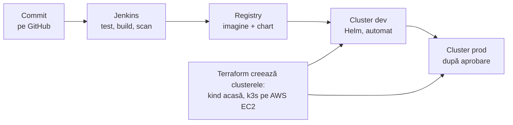

# Plan de învățare DevOps: Docker, Kubernetes, Terraform, Cloud

## Summary
Planul săptămână cu săptămână pentru schimbarea jobului spre DevOps / Platform Engineer.
Versiunea 2 (2026-11-19): include corecturile din review (Gateway API în loc de ingress-nginx,
CloudNativePG în loc de Bitnami, kubeadm pentru CKA, S3 `use_lockfile`, capcane kind/Jenkins/ECR).
Detalii despre capcane: [[devops-homelab-pitfalls]]. Bifează pe măsură ce avansezi.

## Obiectivul și proiectul final

În aproximativ 16 săptămâni, cu 6–8 ore pe săptămână, construiești acasă un sistem complet de livrare:
codul ajunge automat, prin Jenkins, într-o imagine Docker, apoi într-un registry și apoi în Kubernetes,
iar infrastructura e descrisă în Terraform. Totul stă pe GitHub, ca dovadă pentru interviuri.

Avantajul tău: 8 ani de Jenkins, Shared Libraries, Artifactory și build-uri reproductibile. Docker și
Kubernetes sunt aceeași idee (mediu identic oriunde, artefacte versionate), cu alte unelte.

**Aplicația demo:** un mic API în Python (Flask sau FastAPI) cu `/health` și `/items`, plus câteva teste.
Nu contează aplicația, contează drumul ei până în producție.

**La final vei avea:**
- repo `devops-homelab` pe GitHub, cu README și diagramă;
- pipeline Jenkins scris de tine, cu Shared Library;
- deploy automat în Kubernetes cu Helm, plus monitorizare (Prometheus + Grafana);
- infrastructură creată cu Terraform, local și în AWS;
- CV actualizat și CKA programat.

## Săptămâna 0: setup acasă

- [x] Hardware: minim 16 GB RAM și 50 GB liberi pe disc.
- [ ] **WSL2 + Ubuntu** (`wsl --install` în PowerShell ca administrator). De aici lucrezi în terminalul Ubuntu.
- [ ] Limită de memorie pentru WSL în `%UserProfile%\.wslconfig` (de ex. `memory=10GB`), ca să nu blochezi Windows.
- [ ] **Docker Desktop** cu integrare WSL2, sau Docker Engine direct în Ubuntu (mai ușor). Test: `docker run hello-world`.
- [ ] **kubectl**, **kind**, **helm**, **terraform**. Test: fiecare răspunde la `--version`.
- [ ] **VS Code** cu extensiile WSL, Docker, Kubernetes, HashiCorp Terraform.
- [ ] Git cu cheie SSH; repo public `devops-homelab` pe GitHub.
- [ ] Aplicația demo în Python, rulată local fără Docker, cu 2–3 teste `pytest`.
- [ ] **Cumpără voucherul CKA acum** (reducerile de Black Friday / Cyber Monday, de obicei 40–50%; valabil 12 luni).

- [ ] **Gata când:** `docker run hello-world` merge, iar primul commit e pe GitHub.

## Faza 1 (săpt. 1–3): Docker

La final, aplicația rulează într-o imagine mică și sigură și pornește cu baza de date dintr-o singură comandă.

**Săptămâna 1: bazele**
- [ ] Imagine vs. container, layers, registry; `run`, `ps`, `logs`, `exec`, `stop`, `rm`.
- [ ] nginx, postgres, redis din imagini oficiale; intră în ele cu `docker exec -it`.
- [ ] Porturi (`-p`), variabile de mediu (`-e`), volume (`-v`).

**Săptămâna 2: Dockerfile**
- [ ] Dockerfile pentru aplicația demo.
- [ ] **Multi-stage build** și imagine slim; compară dimensiunile.
- [ ] Utilizator non-root, `HEALTHCHECK`, `.dockerignore`.
- [ ] Tag-uri (`app:1.0.0`, `app:git-sha`), exact ca artefactele în Artifactory.

**Săptămâna 3: rețele și compose**
- [ ] Rețele Docker: bridge, comunicare între containere după nume.
- [ ] `docker-compose.yml` cu aplicația + PostgreSQL + volum persistent.
- [ ] Scanare cu **Trivy**; repară vulnerabilitățile ușoare.

- [ ] **Gata când:** `docker compose up` pornește totul, iar imaginea are sub 150 MB.

## Faza 2 (săpt. 4–5): Jenkins în Docker + registry

Terenul tău. Un push pe GitHub produce automat o imagine testată, scanată și urcată în registry.

- [ ] Jenkins cu `docker compose` (`jenkins/jenkins:lts`) și un agent separat cu acces la Docker.
      Înțelege de ce montarea socket-ului Docker e riscantă (Kaniko / BuildKit rootless ca alternativă).
- [ ] **Configuration as Code (JCasC)** și plugin-uri listate într-un fișier. Nimic configurat manual din UI.
- [ ] Registry: `registry:2` local sau **JFrog Container Registry** (gratuit), ca să ai și Artifactory în poveste.
- [ ] `Jenkinsfile` declarativ: checkout → teste → build imagine → scanare Trivy → push cu tag `git-sha`.
- [ ] Pașii comuni într-o **Shared Library** într-un repo separat.
- [ ] Opțional: aceeași etapă de build în **GitHub Actions**.

- [ ] **Gata când:** un commit duce în câteva minute la o imagine nouă în registry, fără pas manual.

## Faza 3 (săpt. 6–9): Kubernetes

Faza cea mai lungă și cea mai cerută la interviuri. Aplicația și baza de date în cluster, accesibile
din browser, totul în fișiere YAML. **Pregătirea pentru CKA începe aici și continuă în paralel cu Fazele 4–5.**

**Săptămâna 6: cluster și obiecte de bază**
- [ ] Cluster kind dintr-un fișier de config (zilnic 1 control-plane + 1 worker; 3 noduri pentru exerciții de scheduling).
- [ ] Pod, ReplicaSet, Deployment, Namespace; `kubectl get`, `describe`, `logs`, `exec`.
- [ ] Încarcă imaginea în cluster (`kind load docker-image`) și primul Deployment.

**Săptămâna 7: rețea și configurare**
- [ ] Service (ClusterIP, NodePort).
- [ ] **Gateway API** (Gateway + HTTPRoute) cu Envoy Gateway sau NGINX Gateway Fabric. Nu ingress-nginx (retras în 2026).
      Citește și obiectul Ingress, pentru că încă apare în multe clustere.
- [ ] ConfigMap și Secret.
- [ ] Liveness și readiness probes, requests și limits.

**Săptămâna 8: stare și scalare**
- [ ] PostgreSQL ca **StatefulSet** cu PersistentVolumeClaim (scris de tine, ca să înțelegi mecanismul).
- [ ] Rolling update și rollback (`kubectl rollout undo`).
- [ ] HorizontalPodAutoscaler cu metrics-server.
- [ ] **Kustomize**: overlay-uri `dev` / `prod` peste aceleași YAML-uri (e în curriculumul CKA).

**Săptămâna 9: depanare, securitate, kubeadm**
- [ ] Strică intenționat lucruri (imagine greșită, probe care pică, OOM) și repară-le.
- [ ] RBAC: ServiceAccount, Role, RoleBinding.
- [ ] **Cluster cu kubeadm** pe 2–3 VM-uri (Multipass sau Vagrant) sau în laboratoarele KodeKloud:
      instalare, upgrade, backup/restore etcd, depanare nod cu `systemctl` și `journalctl`. kind nu acoperă asta.
- [ ] CRD-uri și operatori: ce sunt și cum le folosești (pregătire pentru CloudNativePG).
- [ ] **k9s** pentru lucrul zilnic.

- [ ] **Gata când:** `kubectl apply -k k8s/overlays/dev` aduce totul sus, iar aplicația răspunde pe un host din HTTPRoute.

## Faza 4 (săpt. 10–11): Helm, deploy automat, monitorizare

Un commit ajunge singur în `dev`, apoi, cu aprobare, în `prod`.

- [ ] YAML-urile devin un **Helm chart** cu `values-dev.yaml` și `values-prod.yaml`.
- [ ] PostgreSQL cu operatorul **CloudNativePG** (nu chart-ul Bitnami, care nu mai e gratuit din 2025).
- [ ] Rețea Jenkins → kind: `docker network connect kind <agent>` și `kind get kubeconfig --internal`.
- [ ] Registry mirror în config-ul kind (containerd), ca cluster-ul să tragă imaginile din registry-ul tău.
- [ ] Etapa `helm upgrade --install` în namespace-ul `dev`.
- [ ] Pentru `prod`, un pas de `input` (aprobare manuală).
- [ ] Chart-ul urcat ca artefact versionat în registry (OCI).
- [ ] **Prometheus + Grafana** cu `kube-prometheus-stack` (obligatoriu, nu opțional: se întreabă mereu la interviu).
      Un dashboard pentru aplicația ta și o alertă simplă.
- [ ] Opțional, dar foarte căutat: **Argo CD** pentru GitOps (Jenkins actualizează tag-ul în Git, Argo CD face deploy).

- [ ] **Gata când:** un commit ajunge în `dev` fără intervenție, iar în `prod` după un click de aprobare.
- [ ] **Începe să aplici la joburi** (vezi Faza 7).

## Faza 5 (săpt. 12–13): Terraform local

Terraform gratuit, fără cont de cloud, cu provider-ele Docker și Kubernetes.

- [ ] Ciclul `init`, `plan`, `apply`, `destroy`; provider, resource, variable, output.
- [ ] Cu `kreuzwerker/docker`: containerele pentru registry și Jenkins.
- [ ] Cu `kubernetes` și `helm`: namespace-urile și chart-ul aplicației.
- [ ] **State**: unde stă, de ce nu se pune în Git, ce e drift.
- [ ] **Module** reutilizabile, ca Shared Libraries.
- [ ] `terraform fmt`, `validate`, `plan` ca etapă în pipeline.

- [ ] **Gata când:** `terraform destroy` urmat de `terraform apply` readuce mediul identic.

## Faza 6 (săpt. 14–16): AWS cu Terraform

Rețea și server în AWS, doar din Terraform, apoi totul șters ca să nu plătești.

- [ ] **Înainte de orice:** cont nou cu MFA, utilizator IAM separat (nu root), **alertă de buget** mică.
      Oferta gratuită s-a schimbat în iulie 2025 (credite, nu 12 luni): verifică pagina AWS.
- [ ] Concepte: IAM (useri, roluri, politici), VPC, subrețele publice/private, Security Groups, S3.
- [ ] Terraform cu **state remote în S3** și blocare nativă (`use_lockfile = true`; DynamoDB nu mai e necesar).
- [ ] Din Terraform: VPC + subrețea + Security Group + EC2 **t3.small** (t3.micro e prea mic pentru k3s).
      Atenție: IP-ul public IPv4 se plătește (~$0.005/oră).
- [ ] Pe EC2: **k3s** și deploy cu chart-ul tău Helm. Evită EKS (se plătește pe oră).
- [ ] Imaginile în **ECR**, accesate prin rol IAM, fără chei pe server. Token-ul ECR expiră în 12 ore:
      adaugă un cron / credential helper care îl reîmprospătează pentru k3s.
- [ ] La final de sesiune: `terraform destroy` și verificare în consolă că nu a rămas nimic pornit.

- [ ] **Gata când:** o comandă ridică mediul în AWS, aplicația răspunde pe IP-ul public, altă comandă îl șterge complet.

## Faza 7: CV, GitHub, certificări, interviuri

Nu așteaptă finalul. Începi să aplici după Faza 4.

**GitHub**
- [ ] README cu diagrama, pornire în 3 comenzi, ce ai învățat.
- [ ] Commit-uri regulate, cu mesaje clare.

**CV (după Faza 4)**
- [ ] Titlu: **DevOps / Platform Engineer** în loc de „CI/CD & Build Systems Engineer”.
- [ ] Secțiune „Projects” cu `devops-homelab` și link la GitHub.
- [ ] Docker, Kubernetes, Helm, Terraform, AWS la skills doar după ce le-ai folosit în proiect.
- [ ] Experiența de la job în limbaj de platformă: „reproducible build environments”, „developer platform”, „infrastructure as code”.

**Certificări**
- [ ] 1. **CKA**: pregătire în paralel din Faza 3 până în Faza 5, examen în săpt. 14–18.
      Cele 2 sesiuni killer.sh incluse le folosești în ultima săptămână.
- [ ] 2. **HashiCorp Terraform Associate**, după Faza 5 (sau mai devreme, ca victorie rapidă: e mai ieftin și mai ușor).
- [ ] 3. **AWS Solutions Architect Associate**, după Faza 6.

**Interviuri**
- [ ] 5 povești concrete din experiența ta (o problemă de build rezolvată, o îmbunătățire măsurabilă, un onboarding simplificat).
- [ ] Explică în 2 minute ce se întâmplă de la commit până la producție în proiectul tău.
- [ ] Întrebări frecvente: Deployment vs. StatefulSet, depanare `CrashLoopBackOff`, Terraform state,
      de ce Gateway API, ce e un operator, cum ai securiza agentul Jenkins.

## Resurse

| Subiect | Resursă | De ce |
| --- | --- | --- |
| Docker | [docs.docker.com/get-started](https://docs.docker.com/get-started/) | Tutorialul oficial, gratuit |
| Kubernetes | [kubernetes.io/docs/tutorials](https://kubernetes.io/docs/tutorials/) | Documentația e permisă la examenul CKA |
| Kubernetes + CKA | KodeKloud (curs CKA cu laboratoare), killer.sh | Laboratoare practice, simulator de examen |
| Gateway API | [gateway-api.sigs.k8s.io](https://gateway-api.sigs.k8s.io/) | Înlocuitorul Ingress |
| CloudNativePG | [cloudnative-pg.io](https://cloudnative-pg.io/) | PostgreSQL în Kubernetes cu operator |
| Terraform | [developer.hashicorp.com/terraform/tutorials](https://developer.hashicorp.com/terraform/tutorials) | Tutoriale oficiale, inclusiv Docker și AWS |
| Jenkins | [jenkins.io/doc](https://www.jenkins.io/doc/) | JCasC și agenți Docker |
| Exerciții | [roadmap.sh/devops](https://roadmap.sh/devops) | Harta subiectelor și proiecte |

## Reguli de lucru

- Ritm: 3 sesiuni pe săptămână de câte 2 ore (de ex. marți, joi, sâmbătă dimineața). Constanța bate maratoanele.
- 70% practică, 30% teorie. Fiecare lecție se termină cu un commit.
- `NOTES.md` în repo cu ce ai învățat și ce te-a blocat. Lecțiile importante le muți și în `second_brain/lessons/`.
- Blocat peste 30 de minute: caută eroarea exactă, apoi întreabă-mă.
- Dacă rămâi în urmă, nu sări peste Kubernetes; scurtează partea de cloud.
- Înainte de fiecare fază, recitește [[devops-homelab-pitfalls]]: uneltele se schimbă repede.

## Open questions
- Data exactă a examenului CKA.
